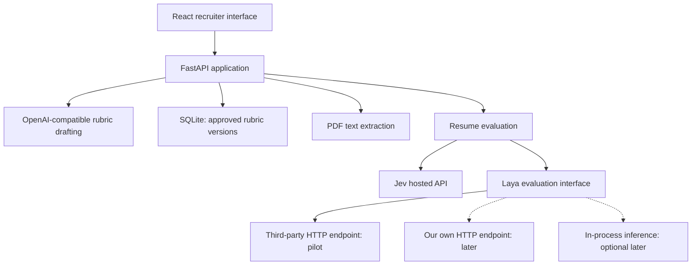

# Architecture and contracts

The HTTP-hosted pilot described here is implemented. Optional in-process Laya, OCR, public deployment, and provider qualification remain deferred.



## Module boundaries and flow

React owns the draft editor, extraction review, approved-version selection, and independent provider result displays. FastAPI owns validation, approval, persistence, extraction, orchestration, and server-side credentials. Pydantic defines the canonical schema. The drafting module returns a validated draft; the rubric store appends and retrieves immutable snapshots; the extractor returns editable text; a shared evaluator interface has Jev and Laya adapters. The Laya module places its seam at `evaluate(state, questions)` and contains transport/model details; inject its configured adapter during backend composition. An HTTP adapter handles third-party and compatible self-hosted endpoints. An in-process adapter is optional later work. No provider-specific branches belong in the UI, rubric store, or orchestrator. See [ADR 0002](adr/0002-swappable-hosted-laya.md) for the hosting decision and current shortlist.

An evaluation resolves an approved version on the server, snapshots reviewed text and canonical questions, validates budgets, then starts the two adapters independently. The frontend submits only the version reference and reviewed text, never an alternative question set. Domain and stable question IDs are metadata retained by the orchestrator; adapters receive the same ID-keyed question map, instructions, and criteria.

## Canonical question and rubric format

The discriminated union uses `type` and these fields:

| Type | Required common fields | Type-specific fields |
| --- | --- | --- |
| `choice` | `id`, `domain`, `instructions`, `type` | `criteria`: object of 2-255 unique nonempty labels to nonempty descriptions; Laya's token budgets may impose a lower practical limit. |
| `score` | Same | `criteria`: ordered array of 2-10 distinct, nonempty descriptive levels; indices are zero-based. |
| `noul` | Same | `instructions` states an explicit yes/no proposition; optional `criteria` maps `false` and `true` to nonempty no/yes descriptions (both keys required when supplied). |

All common strings must be nonempty after trimming. IDs are unique in a version and remain stable for the same question across revisions. Keep criterion order intact. Do not coerce arbitrary values into strings/numbers. Reject unknown discriminators, extra schema fields, nonfinite numbers, and ambiguous criteria. Each draft has a nonempty `role`, a nonempty `questions` array when submitted for approval, and `creation_source`. A revision carries a `base_version` reference; new IDs and timestamps are server-assigned. JSON examples describe the contract, not executable schemas:

```json
{
  "role": "Backend engineer",
  "creation_source": "manual",
  "questions": [
    {
      "id": "backend_evidence",
      "domain": "Backend development",
      "type": "choice",
      "instructions": "What backend-development evidence is documented in the resume?",
      "criteria": {
        "documented": "The resume describes a backend project and the candidate's contribution.",
        "insufficient": "The reviewed text does not document a backend contribution."
      }
    }
  ]
}
```

Both modes use this schema. Persisted snapshots add `id`, positive integer `version`, and `created_at` (UTC ISO 8601). A base reference identifies `{id, version}`. Job descriptions and candidate state are not stored with the rubric. Pydantic models enforce these constraints at the API boundary.

## HTTP interfaces

All JSON responses and errors use `Cache-Control: no-store`. Errors expose a safe `code`, `message`, and optional field details, without echoing inputs or provider bodies.

| Interface | Intended request and response |
| --- | --- |
| `POST /api/rubrics/draft` | `{role, job_description}` -> validated draft with `creation_source=assisted`; never saves or approves. |
| `GET /api/rubrics` | List rubric ID, role, and available version numbers/timestamps; no resume information. |
| `GET /api/rubrics/{id}/versions/{version}` | Retrieve the exact immutable snapshot, or 404. |
| `POST /api/rubrics` | Explicit approval of a complete validated draft, with `base_version` for revisions -> 201 immutable snapshot. New rubric gets a new ID/version 1; revision appends to its base rubric. |
| `POST /api/extract` | One multipart PDF `file` -> `{text}`; no storage. |
| `POST /api/evaluate` | `{rubric: {id, version}, reviewed_text}` -> exact rubric reference and separate `jev` and `laya` outcomes. |

Invalid user inputs use 422, upload overflow 413, unreadable/empty PDF 422, missing resources 404, conflicting revision base 409, busy single-resume evaluator 409, and unavailable drafting configuration 503. Draft-provider failures use 502/504. Malformed evaluation input is a request error; after evaluation is accepted, provider-specific failures are outcome errors and the response remains 200 even if both providers fail. Missing Jev credentials or Laya configuration/endpoint failures must not erase a valid other-provider outcome.

## Drafting adapter

`DRAFTING_URL` is the full configurable Chat Completions URL; `DRAFTING_MODEL` and `DRAFTING_API_KEY` must be explicitly set. Use asynchronous HTTPX with bounded timeouts, bearer credentials, and `response_format: {"type": "json_object"}`. The prompt explicitly requests JSON and supplies the rubric contract. Parse the completion and validate it locally; assign trusted creation metadata on the server. Refusal, incomplete output, invalid JSON, schema failure, missing settings, and unsupported JSON mode are actionable errors. Never silently fall back to unvalidated text or approve the output.

JSON mode provides JSON syntax rather than schema enforcement, so local validation remains necessary. The configurable endpoint must actually support that mode. See [official OpenAI JSON mode guidance](https://developers.openai.com/api/docs/guides/structured-outputs?api-mode=chat).

## Evaluation adapter contract

The `evaluate(state, questions)` interface returns either `{status: "ok", backend, model, answers, elapsed_ms}` or `{status: "error", backend, model, error: {code, message}, elapsed_ms}`. Timing uses a monotonic clock and includes the hosted round trip. `backend` identifies the configured host; the adapter preserves served model and usage metadata when returned. Validated provider answer fields remain in memory. Billing units must be verified per host rather than assumed to count the shared resume only once. Confidence is not normalized into a shared correctness score and candidate outcomes are not persisted.

Jev uses asynchronous HTTPX against `https://api.typesafe.ai/v1/systemone` with `JEV_API_KEY` and pinned `model=jev-1.13.0`. Map question IDs to typed questions. Preserve Choice's `choice`, `probabilities`, `confidence`; Score's `score`, `legend`, `probabilities`, `confidence`; and Noul's `noul`. Score can be fractional. These answer fields and the hosted endpoint are documented in the [Jev API reference](https://docs.typesafe.ai/api).

For the pilot, Laya uses asynchronous HTTPX to the server-configured full `LAYA_URL`, with `LAYA_API_KEY`, endpoint-specific `LAYA_MODEL`, and `max_len=8192`. Use the System One request shape (`state`, ID-keyed `questions`, model selector and supported length controls), never Chat Completions. The selected Boundless defaults are `LAYA_URL=https://api.inference.boundless.network/v1/systemone` and `LAYA_MODEL=convaiinnovations/laya`; send `max_len=8192` explicitly. Authenticate with a Boundless bearer key stored in server-side `LAYA_API_KEY`. Other compatible hosts may require a different identifier. The adapter owns field mapping and authentication. Require the multilingual checkpoint or a verified equivalent full-context configuration; a generic Laya alias does not prove that requirement. Preserve the served model/routing metadata. Missing configuration, unsupported controls, or unverified no-truncation behavior is an actionable Laya error. Never silently substitute a shorter context or another provider.

The same HTTP adapter can target our own compatible `laya-serve` by changing deployment settings. A future `LAYA_BACKEND=local` adapter uses `Router(models={"multilingual": checkpoint}, device="cpu")` then `predict(state, questions, model="multilingual", max_len=8192)` and imports the optional runtime lazily. Hosted mode never imports that runtime or downloads tokenizers/weights as a side effect. See [Laya HTTP interface](https://nandhakishorm.github.io/laya/http-api/) and [Router source](https://github.com/NandhaKishorM/laya/blob/main/laya/router.py).

Preserve available Laya answer fields such as `answer_confidence` and `action.act_probability`, alongside typed answers, distributions, and `confidence`; hosted endpoints may omit local-package extras. Required typed fields are validated, optional fields are not manufactured. Do not treat provider confidence fields as interchangeable. Response validation must match the selected endpoint's documented contract; the optional local package version does not pin a remotely served model.

Before displaying an outcome, require exactly the requested question ID set, matching types and labels, and correct legend/level mappings. Validate probabilities/confidence/Noul within [0,1], finite Score within [0, number of levels - 1], and distributions summing to 1 within a provider-specific numerical tolerance: Jev initially 1e-5; Laya at most `number_of_options * 0.00005 + 1e-8` to allow its four-decimal rounding. Do not repair bad labels, clamp values, silently omit answers, or manufacture fields a provider does not return.

## Token budgets and execution

One Uvicorn backend process allows one active resume comparison; reject additional runs as busy. Start Jev and hosted Laya work asynchronously with finite timeouts and capture errors independently. Start with one request per provider and no automatic billable retries. Use configured HTTPS endpoints for third parties; do not accept endpoint URLs from evaluation requests or forward bearer credentials across redirects. A failure never causes a hidden request to a second Laya host.

If local inference is added later, one lazy model runs in a worker thread with a lock covering initialization/inference. Cancelling an awaiting thread does not stop inference, so hold the busy slot until that work finishes. Hosted latency and optional local CPU latency are unmeasured.

For hosted Laya, qualify the endpoint using synthetic boundary cases and a documented guarantee that over-budget state, instructions, and criteria are rejected rather than truncated. Use endpoint-compatible counting where available, or documented rejection by the provider; a character heuristic and an advertised "8K" window are insufficient. Do not silently download a tokenizer in hosted mode. Without a verified rejection/counting mechanism, fail clearly. Boundless documents 422 for context/criterion overflow, but its checkpoint routing still needs qualification; laya-ai.com advertises length controls but its no-truncation behavior remains untested. See [hosted shortlist](adr/0002-swappable-hosted-laya.md).

For optional local Laya, count the exact serialized inputs using the checkpoint tokenizer without truncation: state, question instructions, every rendered option/criterion, and model-added special tokens. Reject if any actual input would exceed 8192; checking resume tokens alone is insufficient. The inspected Laya 0.4.4 `build_head` caps each rendered option at 48 tokens and shares a head budget across instructions/options (helper default 192; the loaded checkpoint's configuration may differ). Validate those budgets too, or explicitly raise the head budget within the total limit; reject any instruction/criterion that would be clipped. Inspect `render_options`, `build_head`, and `build_sequence` when implementing the guard. See [Laya sequence source](https://github.com/NandhaKishorM/laya/blob/main/laya/common.py). Do not call a truncating tokenizer for validation or silently shorten text/questions. The documented extended multilingual limit requires explicitly setting `max_len`; see [Laya long-document guidance](https://github.com/NandhaKishorM/laya#quickstart).

For Jev, validate both total state-plus-all-questions budget (64k) and state-plus-longest-question budget (32k) using provider-compatible tokenization, including serialization overhead. The exact counting mechanism is a future implementation prerequisite; do not substitute a character count and label it exact. If a reliable count is unavailable, fail clearly or rely on a documented provider rejection that never truncates. A budget error is isolated to that provider. See [Jev model limits](https://docs.typesafe.ai/models).

## Persistence and candidate-data lifetime

Use Python's built-in `sqlite3`, parameterized statements, and transactions. A rubric version row holds rubric ID, version, role, immutable question/criteria JSON, creation source, base-version reference when present, and UTC timestamp. A composite `(id, version)` primary key and an atomic append transaction assign monotonically increasing versions. Treat updates/deletes as unsupported; stale-base approval is a conflict and must reload the latest version. Reads return exact snapshots. Run blocking database work outside the async event loop, with connections owned by the executing thread.

SQLite stores approved rubric versions only. Drafts, job descriptions, candidate bytes/text, and provider results are transient. Stream and bound uploads to 10,000,000 bytes; use an in-memory buffer/BytesIO for pypdf. FastAPI's default `UploadFile` may spool to disk, so the extraction implementation must avoid that default disk path, including multipart parsing. Check PDF content as well as declared MIME type; reject unreadable encryption, corrupt PDFs, and no useful text with a re-export/text-PDF suggestion. Parsing also needs bounded time/resource handling before real candidate use.

Disclose configured Jev/Laya recipients before evaluation. Our memory-only policy does not establish provider retention, training use, data residency, or immunity from leaks; privacy qualification in ADR 0002 applies before real candidate use. Do not send candidate text to the drafting endpoint.

Clear frontend component state on reset/replacement and suppress stale async responses. Release backend buffers and result references after response completion; do not cache evaluations. Browser requests and responses, logs, tracing, exception details, multipart parser temp files, SQLite, and local storage must not persist candidate content. Memory release is not secure erasure and cannot prevent OS paging. For optional local inference, configure Hugging Face assets under ignored `HF_HOME`; model assets are not candidate-data storage. No weights are downloaded in this milestone.

## Local configuration and serving

Run from the repository root so `SQLITE_PATH` and optional `HF_HOME` resolve consistently. The server loads root `.env` before composing provider clients; no secrets belong in `VITE_*` variables. Configuration is validated at use: manual rubrics and extraction work without drafting credentials, and provider failures appear independently. Default `LAYA_BACKEND=http`; the HTTP adapter requires URL/key/model and ignores local checkpoint/device/cache settings. A later `local` choice must validate those local settings. Changing endpoints is an operator configuration change, not a recruiter workflow. `/api/status` reports configured readiness without exposing credentials.

Vite is configured at `127.0.0.1:5173` and proxies `/api` unchanged to FastAPI at `127.0.0.1:8000`. Run Uvicorn with `--host 127.0.0.1 --workers 1`. Same-origin proxying avoids a separate CORS setup. After `npm run build`, FastAPI serves `frontend/dist`, with `/api` routes registered first. Local binding is the pilot boundary; public hosting/authentication is deferred.

## Verification and remaining qualification

Automated tests cover manual and assisted validation, invalid JSON-shaped drafts, missing drafting configuration, approval-only evaluation, revision immutability and stale bases, exact version lookup, corrupt/oversized/empty PDFs, independent provider failure, provider answer IDs/types/labels/ranges/distributions, and synthetic candidate/job-data absence from SQLite. The UI suppresses stale extraction/evaluation responses and clears results when reviewed inputs change. HTTPX redirects are disabled and the adapter never falls back to another host.

Before real resumes, use synthetic inputs to test encrypted/scanned/page-limit PDFs, hosted timeouts and rate limits, exact provider token boundaries and question overhead, served checkpoint identity, returned usage and billing, and all three question types. Review database, logs, browser persistence, temp files, and OS/process behavior during an instrumented run. Measure latency and resume quality/calibration. If the local adapter is added, separately test its tokenizer budgets, thread lock, cold/warm latency, and memory.
